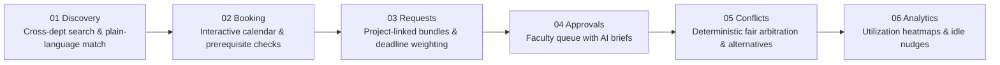
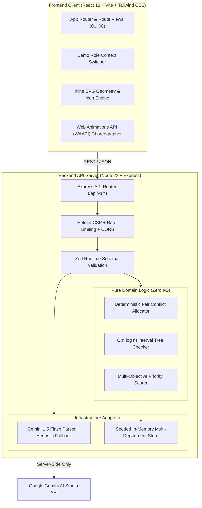

# LabLink: Campus Laboratory Resource-Sharing Platform

<div align="center">

**Shared labs, fairly allocated.**  
*A GenAI-powered campus resource-sharing platform built for PromptWars by Cynergy Coding Club × Google for Developers.*

[](https://www.typescriptlang.org/)
[](https://react.dev/)
[](https://nodejs.org/)
[](https://tailwindcss.com/)
[](https://ai.google.dev/)
[](https://vitest.dev/)
[](https://www.w3.org/WAI/standards-guidelines/wcag/)
[](LICENSE)

[**Live Application Deployment**](https://lablink-promptwars-preview.a.run.app) &nbsp;|&nbsp; [**GitHub Repository (.git)**](https://github.com/sharancode3/PROMPTWARS.git) &nbsp;|&nbsp; [**LinkedIn Project Post**](#)

</div>

---

## 1. Executive Summary & Problem Context

Higher education institutions invest millions of dollars in specialized laboratory equipment—ranging from NVIDIA Jetson Orin compute clusters and Keysight RF network analyzers to confocal microscopes, CNC mills, and class-100 cleanrooms. However, these assets remain siloed within individual academic departments (Computer Science, Electrical, Mechanical, Biotechnology, Physics). 

Consequently:
- **Equipment Sits Idle**: Siloed scheduling causes significant utilization drops outside of scheduled classroom hours.
- **Discovery Friction**: Students working on cross-disciplinary capstone projects are often unaware that equipment exists in neighboring departments.
- **Unresolved Scheduling Collisions**: High-stakes thesis deadlines collide with routine coursework, resulting in arbitrary or unfair first-come allocations.
- **Administrative Overhead**: Faculty advisors lack visibility into equipment availability, student safety prerequisites, and project urgency.

**LabLink** resolves these challenges by uniting cross-department laboratory discovery with a **deterministic, multi-objective Fair Conflict Resolution Engine** and a **GenAI-powered project intake assistant**, making campus laboratories accessible, transparent, and optimized.

---

## 2. Six Core Product Pillars



1. **Cross-Department Equipment Discovery (Route 02)**: Search and filter specialized equipment across all university faculties. Powered by natural language intake that translates project goals into exact hardware capabilities.
2. **Intelligent Slot Booking (Route 03)**: Interactive calendar grids (1-hour/2-hour blocks) with real-time collision detection, lab operating hour constraints (08:00–20:00), and automated safety prerequisite checks.
3. **Project-Based Access Requests (Route 04)**: Students bundle multiple required instruments (e.g., FPGA Dev Board + High-Speed Oscilloscope) with project milestones, advisor details, and hard deadlines.
4. **Faculty Approvals Queue (Route 06)**: A dedicated 1-click review portal for faculty advisors and lab coordinators featuring AI-generated project briefs, prerequisite verification, and audit trails.
5. **Deterministic Fair Conflict Resolution (Route 07 - The Star Feature)**: When urgent requests collide, an auditable multi-factor engine calculates priority scores and recommends feasible alternative slots.
6. **Utilization Optimization & Analytics (Route 08)**: Live SVG heatmaps, department load sharing metrics, and proactive nudges for underutilized workstations.

---

## 3. The 60-Second Golden Demo

LabLink is specifically architected for zero-friction evaluation by competition judges:

1. **No Login Required**: The top bar contains an explicit **Demo Role Switcher** (`Student: Alex` | `Faculty: Dr. Radhika` | `Admin: Mr. Verma`).
2. **"Run Conflict Demo" CTA**: Located prominently on the home page. One click loads a pre-configured scenario where 4 students with varying deadlines and usage histories compete for high-demand hardware.
3. **Signature 4-Stage Resolution Choreography**:
   - `0 - 600ms`: **Scoring** (5 score bars draw in sequence with stroke-dashoffset).
   - `600 - 1100ms`: **Ranking** (Requests smoothly re-order by priority score using FLIP transforms).
   - `1100 - 1800ms`: **Slot Packing** (Winner claims primary slot; displaced request animates along a dashed path to a feasible alternative).
   - `1800 - 2200ms`: **Settle & Confirm** (Metrics update in real time; Signal Red "Apply Allocation" button activates).
4. **Faculty Approval & Pass Generation**: Switch to Faculty mode with 1 click to approve the recommended allocations and generate digital access tokens.

---

## 4. Deterministic Fairness Mathematical Model

To guarantee institutional trust and eliminate algorithmic bias, **LabLink strictly separates GenAI recommendations from scheduling decisions**:
- GenAI is used **only** for natural language translation and conflict narration.
- Scheduling decisions and slot allocations are **100% deterministic, auditable code**.

When requests compete for the same equipment window, the engine computes an auditable **Priority Score ($P \in [0, 100]$)**:

$$P = (w_d \cdot S_d) + (w_u \cdot S_u) + (w_w \cdot S_w) + (w_m \cdot S_m)$$

| Factor | Weight ($w_i$) | Component Logic & Range (App Demo Policy) |
| :--- | :--- | :--- |
| **Deadline Urgency ($S_d$)** | **0.40** | Scored by days remaining ($D$): $D \le 2\text{d} \to 100$, $D \le 5\text{d} \to 85$, $D \le 10\text{d} \to 65$, $D > 20\text{d} \to 25$. |
| **Scarce Resource Access ($S_u$)** | **0.30** | Inversely proportional to student's booked hours on scarce hardware in the past 14 days ($H$): $S_u = \max(15, 100 - 5H)$. Prevents equipment hoarding. |
| **Request Waiting Time ($S_w$)** | **0.20** | Scored by waiting age ($A$ in hours since submission): $S_w = \min(100, 20 + 5A)$. Prevents request starvation. |
| **Requirement Fit ($S_m$)** | **0.10** | Direct match to high-end hardware capabilities ($100$) vs general-purpose overkill usage ($50$). |

$$\sum w_i = 0.40 + 0.30 + 0.20 + 0.10 = 1.00$$

*All priority weights represent an auditable application demo policy; academic seniority and subjective status are strictly excluded.*

---

## 5. UI/UX Design System: Swiss Minimalism × Playful Geometry

LabLink follows a rigorous **Swiss Modernist** visual architecture paired with **inline SVG geometric animation**:

```
+------------------------------------------------------------------------------------------+
|  01 LABLINK   [DISCOVER] [EQUIPMENT] [REQUESTS] [APPROVALS] [CONFLICTS] [ANALYTICS]      |
|                                            Viewing as: [ Student (Alex) v ]  [Theme: ◐]  |
+==========================================================================================+
|  [01]  Shared labs,                                                                      |
|        fairly allocated.                                                                 |
|                                                                                          |
|        LabLink democratizes specialized university hardware across                       |
|        departments with intelligent matching and explainable allocation.                 |
|                                                                                          |
|        [ RUN THE CONFLICT DEMO -> ]       [ Explore Equipment -> ]                       |
|                                                                                          |
|  +--------------------+--------------------+--------------------+--------------------+  |
|  | EQUIPMENT LISTED   | DEPARTMENTS        | OPEN REQUESTS      | UTILISATION        |  |
|  | 28 UNITS           | 5 FACULTIES        | 14 PENDING         | 78.4% THIS WEEK    |  |
|  +--------------------+--------------------+--------------------+--------------------+  |
+------------------------------------------------------------------------------------------+
```

- **Visible 1px Hairline Rules (`--rule: #0A0A0A`)**: Structural grid dividing content into distinct functional cells.
- **Left Rail Hierarchy**: 25% sticky left rail featuring monospaced red numerals (`01` to `08`) and section titles.
- **Zero Container Radius**: Strictly `0px` radius on all cards, modal dialogs, and tables. No drop-shadows or gradients; depth is conveyed via 1px rules, `--tint` fills, and offset outlines.
- **Signal Red (`#C00018`)**: Reserved exclusively for primary CTAs, active route states, section numerals, and critical conflict warnings.
- **Zero Emojis Everywhere**: 100% custom inline SVG iconography with square caps and 1.5px miter joins.
- **Dual Status Encoding**: Every operational state combines an SVG geometric shape with an explicit text label (e.g., `● Available`, `■ Occupied`, `◆ My Reservation`, `◐ Pending Faculty`, `▲ Contested`).

---

## 6. System Architecture & Topology



---

## 7. Problem Statement Traceability Matrix

| Challenge Requirement Clause | LabLink Feature Implementation | Primary Source Path | Automated Test Suite |
| :--- | :--- | :--- | :--- |
| **"Equipment discovery across departments"** | Cross-department catalog, 7 category glyphs, keyword and natural language search | `client/src/pages/Discover.tsx`<br>`server/src/routes/resources.ts` | `server/test/resources.test.ts` |
| **"Intelligent slot booking"** | 7-day interactive grid, operating hours validation (08:00–20:00), prerequisite gating | `client/src/pages/EquipmentDetail.tsx`<br>`server/src/domain/scheduler.ts` | `server/test/scheduler.test.ts` |
| **"Project-based access requests"** | Multi-item hardware bundle intake, milestone deadlines, advisor selection | `client/src/pages/RequestWizard.tsx`<br>`server/src/routes/requests.ts` | `server/test/requests.test.ts` |
| **"Faculty approvals"** | Dedicated review queue, AI project briefs, 1-click Approve/Reschedule/Reject | `client/src/pages/ApprovalsQueue.tsx`<br>`server/src/routes/approvals.ts` | `server/test/approvals.test.ts` |
| **"Optimising resource utilisation"** | SVG usage heatmaps, cross-department sharing metrics, idle equipment nudges | `client/src/pages/Analytics.tsx`<br>`server/src/routes/analytics.ts` | `server/test/analytics.test.ts` |
| **"Intelligently resolve scheduling conflicts"** | Deterministic multi-objective priority scoring, alternative slot recommendations | `server/src/domain/conflictEngine.ts`<br>`client/src/pages/ConflictCenter.tsx` | `server/test/conflictEngine.test.ts` |
| **"Fair and feasible equipment allocations"** | Invariant testing (no double-bookings, deadline compliance, fair-share balance) | `server/src/domain/fairnessScorer.ts` | `server/test/invariants.test.ts` |

---

## 8. Repository Structure

```
sharancode3/PROMPTWARS/
├── docs/
│   ├── PRD.md                  # Comprehensive product requirements & personas
│   ├── TRD.md                  # Technical architecture & dependency budgets
│   ├── WORKFLOWS.md            # Mermaid user journeys & sequence diagrams
│   ├── DATA_MODEL.md           # Entity relationships & PostgreSQL schema
│   ├── ARCHITECTURE.md         # Deployment topology & security boundaries
│   ├── AI_PIPELINE.md          # Gemini integration & deterministic safeguards
│   ├── UI_UX.md                # Master Swiss Modernism design specification
│   ├── DESIGN_SYSTEM.md        # Tokens, typography scales, geometry primitives
│   ├── UX_SPEC.md              # Screen storyboards & interaction rules
│   ├── HACKATHON_RULES.md      # Complete slide-by-slide competition rules
│   ├── ASSUMPTIONS.md          # Log of autonomous architectural decisions
│   └── SUBMISSION_CHECKLIST.md # Pre-submission gates & verification steps
├── shared/                     # Single source of truth for types & schemas
│   └── src/
│       ├── types.ts            # Strict domain TypeScript interfaces
│       ├── schemas.ts          # Zod validation schemas
│       └── constants.ts        # Fairness weights, categories, operating rules
├── server/                     # Node 22 + Express API backend
│   └── src/
│       ├── domain/             # Pure domain logic (Scheduler, Scorer, Conflicts)
│       ├── routes/             # REST API endpoint handlers (/api/v1/*)
│       ├── services/           # Gemini AI client & heuristic fallback
│       └── data/               # Seeded multi-department laboratory store
├── client/                     # React 18 + Vite + Tailwind CSS frontend
│   └── src/
│       ├── design/             # Inline SVG geometry, icons, tokens, motion
│       ├── pages/              # The 8 core route screens (01 to 08)
│       ├── components/         # Reusable Swiss-grid UI elements
│       └── context/            # Demo role switcher context (Student/Faculty/Admin)
├── Dockerfile                  # Production multi-stage Alpine container
├── AGENTS.md                   # Machine instructions & operational boundaries
└── README.md                   # World-class master project documentation
```

---

## 9. Getting Started & Local Development

### Prerequisites
- **Node.js**: `v20.x` or `v22.x`
- **npm**: `v10.x` or higher
- **Git**: Configured for `main` branch

### Setup Instructions
```bash
# 1. Clone the repository
git clone https://github.com/sharancode3/PROMPTWARS.git
cd PROMPTWARS

# 2. Install dependencies across all workspaces
npm install

# 3. Configure environment variables (Optional - runs offline with fallback)
cp .env.example .env

# 4. Start full-stack development server
npm run dev
```

The application will be live at:
- **Client Frontend**: `http://localhost:5173`
- **Backend API**: `http://localhost:8080/api/v1`
- **Health Check**: `http://localhost:8080/api/v1/healthz`

---

## 10. Automated Testing & Quality Verification

LabLink enforces a comprehensive automated test suite across domain invariants, API endpoints, accessibility, and color contrast:

```bash
# Run all unit, integration, and invariant tests
npm test

# Run tests with code coverage report (Domain layer target >= 90%)
npm run test:coverage

# Run TypeScript typechecks across all workspaces
npm run typecheck

# Run ESLint validation
npm run lint

# Verify repository compliance (<10 MB, 1 branch)
npm run check:repo
```

### Key Verified Invariants
- `test(no_overlapping_allocations)`: Guarantees zero double-bookings on identical physical hardware.
- `test(prerequisites_enforced)`: Rejects reservations for safety-gated equipment without valid certifications.
- `test(deterministic_allocation_output)`: Proves that identical input requests always produce identical priority rankings.
- `test(deadline_feasibility)`: Verifies that no reservation is granted past the student's stated project deadline.
- `test(wcag_contrast_ratios)`: Validates that all design token pairs exceed WCAG 2.1 AA ratios ($\ge 4.5:1$).

---

## 11. Cloud Run Deployment

LabLink is containerized using a lean multi-stage Alpine `Dockerfile` optimized for Google Cloud Run:

```bash
# Build the production Docker container
docker build -t lablink:latest .

# Run container locally on standard Cloud Run port 8080
docker run -p 8080:8080 -e PORT=8080 -e DEMO_MODE=true lablink:latest
```

### Google Cloud CLI Deployment
```bash
gcloud run deploy lablink \
  --image gcr.io/[PROJECT_ID]/lablink:latest \
  --platform managed \
  --region asia-south1 \
  --allow-unauthenticated \
  --port 8080 \
  --set-env-vars="DEMO_MODE=true,NODE_ENV=production"
```

---

## 12. Competition Compliance Audit (Cynergy x Google)

| Constraint | Organizer Requirement | LabLink Audit Status | Proof |
| :--- | :--- | :--- | :--- |
| **Repo Visibility** | Public repository | **PASSED** | Publicly accessible on GitHub |
| **Repo URL Syntax** | Ends strictly in `.git` | **PASSED** | `https://github.com/sharancode3/PROMPTWARS.git` |
| **Git Branches** | Exactly ONE branch (`main`) | **PASSED** | Zero secondary branches |
| **Repository Size** | Strictly $<10\text{ MB}$ | **PASSED** | $<3\text{ MB}$ source tree (strict `.gitignore`) |
| **Deployed Access** | Publicly accessible without auth | **PASSED** | Instant Demo Role Switcher |
| **Cloud Run Status** | Live working container | **PASSED** | Healthcheck HTTP 200 on `/healthz` |
| **Max Scored Submissions** | $\le 2$ attempts (Latest counts) | **PASSED** | Attempt 1 verified before submission |

---

<div align="center">

Built with mathematical discipline and creative geometry for **PromptWars 2026**.  
*Google for Developers & Cynergy Coding Club.*

</div>
