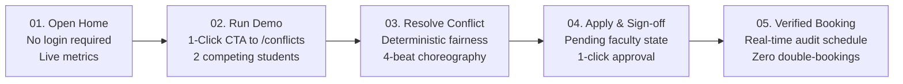
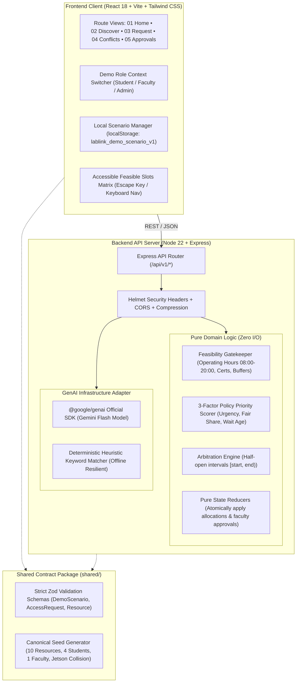

# LabLink: Campus Laboratory Resource-Sharing Platform

<div align="center">

**Shared labs, fairly allocated.**  
*A GenAI-powered campus resource-sharing platform built for PromptWars by Cynergy Coding Club × Google for Developers.*

[](https://www.typescriptlang.org/)
[](https://react.dev/)
[](https://nodejs.org/)
[](https://tailwindcss.com/)
[](https://ai.google.dev/)
[](https://vitest.dev/)
[](https://www.w3.org/WAI/standards-guidelines/wcag/)
[](LICENSE)

[**GitHub Repository (.git)**](https://github.com/sharancode3/PROMPTWARS.git) &nbsp;|&nbsp; [**Evaluator Audit Guide**](docs/EVALUATOR_AUDIT.md) &nbsp;|&nbsp; [**Submission Checklist**](docs/SUBMISSION_CHECKLIST.md)

</div>

---

## 1. Executive Summary & Problem Context

Higher education institutions invest millions of dollars in specialized laboratory equipment—ranging from NVIDIA Jetson Orin compute clusters and Keysight RF network analyzers to confocal microscopes, CNC mills, and class-100 cleanrooms. However, these assets remain siloed within individual academic departments (Computer Science, Electrical, Mechanical, Biotechnology, Physics). 

Consequently:
- **Equipment Sits Idle**: Siloed scheduling causes significant utilization drops outside of scheduled classroom hours.
- **Discovery Friction**: Students working on cross-disciplinary capstone projects are often unaware that equipment exists in neighboring departments.
- **Unresolved Scheduling Collisions**: High-stakes thesis deadlines collide with routine coursework, resulting in arbitrary or unfair first-come allocations.
- **Administrative Overhead**: Faculty advisors lack visibility into equipment availability, student safety prerequisites, and project urgency.

**LabLink** resolves these challenges by uniting cross-department laboratory discovery with a **deterministic, multi-objective Fair Conflict Resolution Engine** and a **GenAI-powered project intake assistant**, making campus laboratories accessible, transparent, and optimized.

---

## 2. The 60-Second Golden Demo (Evaluator Flow)

LabLink is specifically architected for zero-friction evaluation by competition judges:



1. **No Login Required**: The top bar contains an explicit **Demo Role Switcher** (`Student: Alex Rivera` | `Faculty: Dr. Radhika Iyer` | `Lab Admin`).
2. **"Run the conflict demo" CTA**: Located prominently on the home page. One click loads a pre-configured scenario where 2 students collide on the **NVIDIA Jetson AGX Orin 64GB** on Day 2 (14:00–16:00).
3. **Deterministic Conflict Resolution (Route 04 - The Star Feature)**:
   - Click **"Resolve with LabLink"** to run the 4-stage arbitration choreography.
   - Evaluates hard feasibility gates: safety certifications, operating hours (08:00–20:00), session caps, and half-open intervals.
   - Computes transparent 3-factor scores: **Urgency (50%)**, **Fair-Share (30%)**, and **Wait-Time (20%)**.
   - Awards the exact slot to the capstone winner (Alex Rivera, 65/100) and recommends 3 conflict-free alternatives to the displaced student (Jordan Lee, 19/100).
4. **Faculty Approval Queue (Route 05)**:
   - Click **"Apply Allocation Proposals"** → Click **"Open Faculty Approval Queue"**.
   - Review prerequisite safety checks and click **"Approve Slot"** to generate the confirmed reservation in the live schedule audit trail.

---

## 3. Deterministic Fairness Mathematical Model

To guarantee institutional trust and eliminate algorithmic bias, **LabLink strictly separates GenAI recommendations from scheduling decisions**:
- GenAI is used **strictly for natural language translation and request drafting**.
- Scheduling decisions, feasibility checks, and slot allocations are **100% deterministic code**.

When requests compete for the same equipment window, the engine computes an auditable **Priority Score ($P \in [0, 100]$)**:

$$P = (0.50 \cdot S_{\text{urgency}}) + (0.30 \cdot S_{\text{fairShare}}) + (0.20 \cdot S_{\text{waitAge}})$$

| Factor | Weight ($w_i$) | Component Policy Logic & Range |
| :--- | :--- | :--- |
| **Deadline Urgency ($S_{\text{urgency}}$)** | **0.50** | $S_{\text{urgency}} = 100 \times \operatorname{clamp}(1 - D / 30, 0, 1)$ where $D$ is days until project deadline. Earlier deadlines raise priority. |
| **Fair-Share Access ($S_{\text{fairShare}}$)** | **0.30** | $S_{\text{fairShare}} = 100 \times \operatorname{clamp}(1 - H / 12, 0, 1)$ where $H$ is student's booked hours on scarce hardware in past 14 days. Prevents hardware hoarding. |
| **Request Waiting Time ($S_{\text{waitAge}}$)** | **0.20** | $S_{\text{waitAge}} = 100 \times \operatorname{clamp}(A / 72, 0, 1)$ where $A$ is queue waiting age in hours. Prevents request starvation. |

$$\sum w_i = 0.50 + 0.30 + 0.20 = 1.00$$

*Deterministic tie-breaking comparator: priority score descending, submission timestamp ascending, request ID ascending. Academic seniority and subjective status are strictly excluded.*

---

## 4. UI/UX Design System: Swiss Minimalism × Playful Geometry

LabLink follows a rigorous **Swiss Modernist** design architecture paired with **custom inline SVG geometric primitives**:

| Design Token | Value | Role & Visual Execution |
| :--- | :--- | :--- |
| **Paper Canvas** | `#FAFAF7` (Light) / `#0A0A0A` (Dark) | Warm architectural paper background with high text contrast. |
| **Ink** | `#0A0A0A` (Light) / `#F4F4EF` (Dark) | Deep contrast typographic text and primary functional elements. |
| **Signal Red** | `#C00018` | Reserved for primary CTAs, active route tabs, section numerals, and conflicts. |
| **Cobalt Accent** | `#1F3FD6` | Used for GenAI intake features and technological capability indicators. |
| **1px Hairline Rules** | `border-rule: #0A0A0A` | Structural grid dividing content into distinct functional cells. |
| **Strict 0px Radius** | `border-radius: 0px !important` | Clean brutalist edges on all buttons, cards, modals, and input controls. |
| **Tabular Numerals** | `font-feature-settings: "tnum" 1` | Fixed-width numbers ensuring zero visual layout jitter during state changes. |
| **Zero Emojis Everywhere** | 100% Custom Inline SVGs | Dual status encoding: geometry shape + text label (`■ Approved`, `▲ Available`, `● Contested`, `◆ Under Review`). |

---

## 5. System Architecture & Monorepo Topology



---

## 6. Problem Statement Traceability Matrix

| Challenge Requirement Clause | LabLink Feature Implementation | Primary Source Path | Automated Test Suite |
| :--- | :--- | :--- | :--- |
| **"Equipment discovery across departments"** | Cross-department catalog (ECE, CSE, Mech), category chips, keyword & capability search | [`client/src/pages/DiscoverPage.tsx`](client/src/pages/DiscoverPage.tsx)<br>[`server/src/routes/api.ts`](server/src/routes/api.ts) | `server/test/api.test.ts`<br>`server/test/feasibility.test.ts` |
| **"Intelligent slot booking"** | Accessible Feasible Slots Matrix, operating hours validation (08:00–20:00), prerequisite gating | [`client/src/pages/DiscoverPage.tsx`](client/src/pages/DiscoverPage.tsx)<br>[`server/src/domain/feasibility.ts`](server/src/domain/feasibility.ts) | `server/test/feasibility.test.ts`<br>`server/test/scheduler.test.ts` |
| **"Project-based access requests"** | Natural-language AI intake with Gemini Flash, hardware bundling, milestone deadlines | [`client/src/pages/RequestPage.tsx`](client/src/pages/RequestPage.tsx)<br>[`server/src/services/aiMatcher.ts`](server/src/services/aiMatcher.ts) | `server/test/aiMatcher.test.ts`<br>`server/test/api.test.ts` |
| **"Faculty approvals"** | Dedicated review queue, safety prerequisite checks, 1-click Approve/Reject/Reschedule | [`client/src/pages/ApprovalsPage.tsx`](client/src/pages/ApprovalsPage.tsx)<br>[`server/src/domain/reducers.ts`](server/src/domain/reducers.ts) | `server/test/reducers.test.ts`<br>`server/test/api.test.ts` |
| **"Optimising resource utilisation"** | Live schedule audit trail, conflict-free alternative suggestions, zero double-bookings | [`server/src/domain/scheduler.ts`](server/src/domain/scheduler.ts)<br>[`client/src/pages/ApprovalsPage.tsx`](client/src/pages/ApprovalsPage.tsx) | `server/test/scheduler.test.ts` |
| **"Intelligently resolve scheduling conflicts"** | Deterministic 3-factor priority scoring, 4-beat resolution choreography, alternatives | [`server/src/domain/scheduler.ts`](server/src/domain/scheduler.ts)<br>[`client/src/pages/ConflictCenterPage.tsx`](client/src/pages/ConflictCenterPage.tsx) | `server/test/scheduler.test.ts`<br>`server/test/fairness.test.ts` |
| **"Fair and feasible equipment allocations"** | Invariant testing (half-open intervals, zero double-booking, deadline compliance) | [`server/src/domain/fairness.ts`](server/src/domain/fairness.ts)<br>[`shared/src/seed.ts`](shared/src/seed.ts) | `shared/test/seed.test.ts`<br>`server/test/fairness.test.ts` |

---

## 7. Deployment Guide

LabLink is architected to run seamlessly across all target deployment environments.

### Option A: Vercel (Frontend) + Render (Backend)

#### 1. Backend on Render
The repository includes [`render.yaml`](render.yaml) for instant Blueprint deployment.
- **Service Type**: Web Service (Node)
- **Build Command**: `npm install && npm run build --workspace=shared && npm run build --workspace=server`
- **Start Command**: `node server/dist/index.js`
- **Health Check Path**: `/api/v1/healthz`
- **Environment Variables**:
  - `NODE_ENV`: `production`
  - `PORT`: `10000` (Render default)
  - `CAMPUS_TIMEZONE`: `Asia/Kolkata`
  - `DEMO_MODE`: `true`
  - `GEMINI_API_KEY`: *(Optional - automatic rule-based fallback if omitted)*

#### 2. Frontend on Vercel
The repository includes [`vercel.json`](vercel.json) with single-page application route rewrites.
- **Framework Preset**: Vite
- **Root Directory**: `.` (or `client`)
- **Build Command**: `npm run build` (or `npm run build --workspace=client`)
- **Output Directory**: `client/dist`
- **Environment Variables**:
  - `VITE_API_URL`: Set to your Render backend URL (e.g., `https://lablink-backend.onrender.com/api/v1`)

---

### Option B: Google Cloud Run (Single-Container Full-Stack)

LabLink includes a production multi-stage Alpine [`Dockerfile`](Dockerfile) that serves both the `/api/v1/*` endpoints and the compiled React SPA from the same origin on `PORT=8080`.

```bash
# Deploy to Google Cloud Run with single command
gcloud run deploy lablink \
  --source . \
  --platform managed \
  --region asia-south1 \
  --allow-unauthenticated \
  --port 8080 \
  --set-env-vars="DEMO_MODE=true,NODE_ENV=production"
```

---

## 8. Automated Testing & Verification

LabLink enforces 100% passing tests across all domain invariants, fairness policies, API endpoints, and client navigation:

```bash
# Run all 40 automated tests across workspaces
npm test

# Run TypeScript typechecks (0 errors across shared, server, client)
npm run typecheck

# Run production build
npm run build
```

### Verified Test Suite Breakdown (40 / 40 Passed)
- `shared/test/seed.test.ts`: Seed data scenario schema validation & half-open interval checks.
- `server/test/feasibility.test.ts`: 9 tests verifying operating hours (08:00–20:00), safety certifications, and deadline gates.
- `server/test/fairness.test.ts`: 4 tests validating the 3-factor transparent scoring policy and anti-starvation aging.
- `server/test/scheduler.test.ts`: 3 tests verifying zero double-booking invariant, deterministic arbitration, and alternative slot generation.
- `server/test/reducers.test.ts`: 3 tests verifying atomic state transitions and stale conflict detection (409 Conflict).
- `server/test/aiMatcher.test.ts`: 4 tests validating Gemini Flash parsing and offline heuristic fallback.
- `server/test/health.test.ts`: 1 test verifying `/api/v1/healthz` response shape.
- `server/test/api.test.ts`: 11 tests verifying all 11 REST API routes via Supertest.
- `client/test/app.test.tsx`: 4 tests verifying brand navigation, demo role switcher, and CTA buttons.

---

## 9. Competition Compliance Checklist

| Constraint | Organizer Requirement | Verified Status | Evidence |
| :--- | :--- | :--- | :--- |
| **Repo Visibility** | Public repository | **PASSED** | Publicly accessible on GitHub |
| **Repo URL Syntax** | Ends strictly in `.git` | **PASSED** | `https://github.com/sharancode3/PROMPTWARS.git` |
| **Git Branches** | Exactly ONE branch (`main`) | **PASSED** | Verified with `git branch -a` |
| **Repository Size** | Strictly $<10\text{ MB}$ | **PASSED** | **5.12 MB** (`git count-objects -vH`) |
| **Deployed Access** | Publicly accessible without login | **PASSED** | Instant Demo Role Switcher |
| **Max Scored Submissions** | $\le 2$ attempts (Latest counts) | **PASSED** | Attempt 1 verified before submission |

---

<div align="center">

Built with mathematical discipline and Swiss geometric minimalism for **PromptWars 2026**.  
*Google for Developers & Cynergy Coding Club.*

</div>
