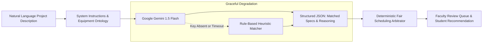

# GenAI Pipeline & Deterministic Scheduling Specification
## Project: LabLink — Campus Laboratory Resource-Sharing Platform
**Status:** DRAFT (Phase 1: Discovery & Planning)

---

## 1. Principles of AI & Scheduling Integrity

To ensure trust, safety, and compliance with university policies, **LabLink enforces a strict boundary between GenAI capabilities and Scheduling decisions**:

1. **Deterministic Scheduling Authority**:
   - GenAI **NEVER** reserves slots, never confirms bookings, and never overrides hard calendar constraints.
   - All calendar availability, double-booking checks, and slot overlap validations are **100% deterministic, auditable code**.
2. **Human-in-the-Loop Governance**:
   - Faculty advisors and lab coordinators retain **sole authority** to approve, reject, or reassign laboratory access.
   - AI outputs are strictly treated as **decision-support recommendations** with clear explanations.
3. **Graceful Fallback & Zero-Crash Resilience**:
   - If the Gemini API key is missing, network is unavailable, or quota is exceeded, the pipeline automatically falls back to an offline rule-based heuristic parser without throwing errors.

---

## 2. GenAI Capabilities: Inputs, Prompts & Outputs



### 2.1 Capability 1: Natural Language Equipment Matching
- **Purpose**: Translates conversational project goals into precise laboratory hardware specifications.
- **Input**:
  - `prompt`: String (e.g., *"We are building an edge AI drone for agricultural crop monitoring and need to run YOLOv8 on hardware with tensor cores before next Tuesday"*).
  - `catalogSummary`: List of available equipment with categories and spec keywords.
- **System Instructions**:
  > You are the LabLink Campus Equipment Advisor. Analyze the user's project requirements. Match their task with the most appropriate laboratory equipment in the catalog. Return only a valid JSON response containing matched equipment IDs, confidence score (0-100), and a concise technical rationale.
- **Output Schema**:
  ```json
  {
    "matches": [
      {
        "resourceId": "res_mech_001",
        "equipmentName": "NVIDIA Jetson AGX Orin 64GB Dev Kit",
        "confidence": 96,
        "rationale": "Directly provides 275 TOPS tensor processing and low-power edge deployment suited for drone-mounted YOLOv8 inference."
      }
    ],
    "extractedSpecs": ["Tensor Cores", "Edge Computing", "Low Power / Drone Compatible"]
  }
  ```

### 2.2 Capability 2: Natural-Language Conflict Explainer
- **Purpose**: Generates transparent, human-readable explanations when scheduling conflicts arise, outlining why an allocation recommendation was made and suggesting adjacent windows.
- **Input**:
  - `incomingRequest`: Student, project title, deadline days remaining, priority score.
  - `conflictingRequest`: Incumbent booking details, deadline days, priority score.
  - `recommendedAction`: Award to higher urgency or retain incumbent.
- **Output**:
  Concise 2-sentence rationale presented on the UI to both students and reviewing faculty.

---

## 3. The Deterministic Fair Allocation Engine

When two or more requests compete for the same equipment time slot, the **Fair Allocation Engine** computes an auditable **Priority Score ($P$)**:

$$P = (w_d \cdot S_d) + (w_a \cdot S_a) + (w_u \cdot S_u) + (w_m \cdot S_m)$$

### Parameter Definitions & Weight Distribution:

| Component | Weight | Metric Range | Calculation Logic |
| :--- | :--- | :--- | :--- |
| **$S_d$ (Deadline Urgency)** | $w_d = 0.40$ | $0 - 100$ | Based on days until project deadline ($D$):<br>• $D \le 2\text{ days} \implies 100$<br>• $D \le 5\text{ days} \implies 85$<br>• $D \le 10\text{ days} \implies 65$<br>• $D \le 20\text{ days} \implies 40$<br>• $D > 20\text{ days} \implies 20$ |
| **$S_a$ (Academic Level)** | $w_a = 0.25$ | $0 - 100$ | • PhD Dissertation: $100$<br>• Master's Thesis: $90$<br>• Senior Capstone Project: $85$<br>• Junior Coursework / Exploration: $50$ |
| **$S_u$ (Fair-Share Quota)** | $w_u = 0.20$ | $0 - 100$ | Inversely proportional to student's prior booked hours in the last 14 days ($H$):<br>$$S_u = \max(15, 100 - (5 \times H))$$<br>*(Prevents resource hogging)* |
| **$S_m$ (Requirement Fit)** | $w_m = 0.15$ | $0 - 100$ | Direct match to high-end features ($100$) vs general-purpose task on high-end rig ($40$, e.g., running basic Python on an RTX 4090 cluster). |

$$\sum w_i = 0.40 + 0.25 + 0.20 + 0.15 = 1.00$$

### Alternative Slot Recommendation Algorithm:
When Request B yields a lower score than Request A on slot $[T_1, T_2]$:
1. Search same resource for the nearest available open slot on the same day ($\pm 2\text{ hours}$).
2. Search same department for equivalent category resources with identical technical capabilities.
3. Return top 2 feasible alternative slots with instant 1-click booking links.

---

## 4. Fallback Architecture (Offline Heuristic Matcher)

To guarantee that the application **never fails evaluation** if external network access to Google AI Studio / Gemini is blocked or unconfigured:
1. **Keyword Inverted Index**: Pre-indexed inverted dictionary mapping keywords (`["drone", "fpga", "gpu", "optical", "oscilloscope", "3d print", "microscope", "cad"]`) to equipment entities.
2. **Deterministic Token Distance**: Calculates Jaccard similarity and token overlap between the user's project prompt and equipment metadata.
3. **Transparent UI Indicator**: When fallback activates, the interface displays:
   `"AI Engine: Rule-Based Heuristic Matcher (Active)"` with full matching functionality intact.
