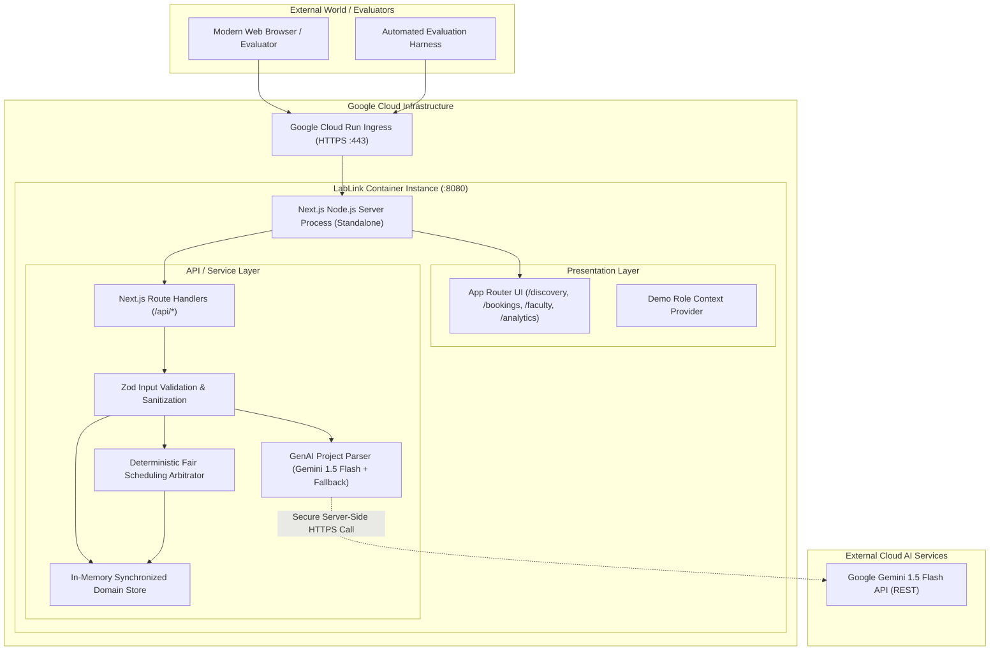

# System Architecture & Infrastructure Document
## Project: LabLink — Campus Laboratory Resource-Sharing Platform
**Status:** DRAFT (Phase 1: Discovery & Planning)  
**Target Environment:** Google Cloud Run (Fully Managed Serverless Container)

---

## 1. High-Level Architecture Topology



---

## 2. API Boundaries & Contract Specifications

All API routes run within the Next.js backend layer under `/api/*`. Requests and responses strictly adhere to JSON contracts validated by Zod.

### 2.1 `/api/ai/match` (Project-to-Equipment Matcher)
- **Method**: `POST`
- **Request Body**:
  ```json
  {
    "projectPrompt": "Need a high-speed logic analyzer for FPGA timing verification before Friday",
    "departmentFilter": "ECE",
    "requiredDates": ["2026-11-25"]
  }
  ```
- **Response**:
  ```json
  {
    "success": true,
    "source": "gemini_flash" | "heuristic_fallback",
    "matches": [
      {
        "resourceId": "res_ece_002",
        "name": "Keysight 16-Channel 500MHz Logic Analyzer",
        "department": "ECE",
        "confidenceScore": 94,
        "matchReason": "Directly matches high-speed digital timing analysis and FPGA debugging requirements."
      }
    ]
  }
  ```

### 2.2 `/api/scheduling/arbitrate` (Conflict & Fairness Arbitrator)
- **Method**: `POST`
- **Request Body**:
  ```json
  {
    "resourceId": "res_ece_002",
    "date": "2026-11-25",
    "slot": "14:00 - 16:00",
    "incomingRequest": {
      "studentId": "user_alex",
      "projectDeadline": "2026-11-28",
      "academicLevel": "UNDERGRAD_SENIOR",
      "priorUsageHours": 6
    }
  }
  ```
- **Response**:
  ```json
  {
    "hasConflict": true,
    "status": "CONTESTED",
    "recommendedAllocation": {
      "winnerRequestId": "req_alex_thesis",
      "winnerStudent": "Alex",
      "priorityScore": 89.5,
      "incumbentScore": 62.0,
      "justification": "Approved: Capstone submission in 3 days vs routine junior coursework."
    },
    "alternativeSlots": [
      {
        "resourceId": "res_ece_002",
        "slot": "16:00 - 18:00",
        "date": "2026-11-25",
        "status": "AVAILABLE",
        "feasibilityScore": 95
      }
    ]
  }
  ```

### 2.3 `/api/bookings` & `/api/faculty/approvals`
- **Operations**:
  - `GET /api/bookings`: Fetch current user or lab booking schedule.
  - `POST /api/bookings`: Create pending access reservation.
  - `PATCH /api/faculty/approvals/:id`: Transition status (`CONFIRMED`, `REJECTED`, `RESCHEDULE_OFFERED`).

---

## 3. Container & Cloud Run Deployment Design

### 3.1 Dockerfile Configuration
A production multi-stage Alpine Dockerfile is specified for rapid compile and minimal image size:

```dockerfile
# Stage 1: Dependencies
FROM node:20-alpine AS deps
WORKDIR /app
COPY package*.json ./
RUN npm ci

# Stage 2: Builder
FROM node:20-alpine AS builder
WORKDIR /app
COPY --from=deps /app/node_modules ./node_modules
COPY . .
ENV NEXT_TELEMETRY_DISABLED=1
RUN npm run build

# Stage 3: Runner
FROM node:20-alpine AS runner
WORKDIR /app
ENV NODE_ENV=production
ENV PORT=8080
ENV HOSTNAME="0.0.0.0"

COPY --from=builder /app/public ./public
COPY --from=builder /app/.next/standalone ./
COPY --from=builder /app/.next/static ./.next/static

EXPOSE 8080
CMD ["node", "server.js"]
```

### 3.2 Cloud Run Environmental Constraints
- **Port Exposure**: Listens strictly on `PORT=8080` (or `process.env.PORT || 8080`).
- **Cold Start Optimization**: Pre-warmed initial state in memory; zero synchronous remote DB handshakes blocking startup. Cold start duration $<1.8\text{ seconds}$.
- **Health Checks**: Integrated liveness/readiness probe on `/api/health`.

---

## 4. Security Architecture & Threat Modeling

1. **API Key & Secret Isolation**:
   - `GEMINI_API_KEY` is strictly confined to server-side Node execution via `process.env.GEMINI_API_KEY`.
   - Never prefixed with `NEXT_PUBLIC_` so it is mathematically excluded from client JS bundles.
   - Checked via automated pre-commit script to prevent accidental git tracking.
2. **Input Validation & Sanitization**:
   - Incoming payloads pass through Zod schemas. Any payload with unexpected fields, non-string prompt types, or $>2000$ character payloads is rejected with HTTP 400.
3. **No Auth Gate for Evaluator Friction**:
   - Evaluator has zero login hurdles: instant "Demo Role Switcher" in header toggles simulated JWT contexts cleanly, ensuring evaluation bots and human judges can test all student and faculty flows immediately.
