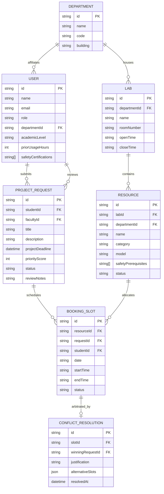

# Data Model & Entity Specifications
## Project: LabLink — Campus Laboratory Resource-Sharing Platform
**Status:** DRAFT (Phase 1: Discovery & Planning)

---

## 1. Entity-Relationship Overview



---

## 2. Schema Details & TypeScript Interfaces

### 2.1 User & Demo Personas
```typescript
export type UserRole = 'STUDENT' | 'FACULTY' | 'LAB_ADMIN';
export type AcademicLevel = 'UNDERGRAD_JUNIOR' | 'UNDERGRAD_SENIOR' | 'POSTGRAD_MASTERS' | 'PHD_RESEARCHER';

export interface User {
  id: string;
  name: string;
  email: string;
  role: UserRole;
  departmentId: string;
  departmentName: string;
  academicLevel?: AcademicLevel;
  priorUsageHours: number;           // Tracked for fair-share quota arbitration
  safetyCertifications: string[];    // e.g. ['ESD_SAFE', 'LASER_SAFETY_L1', 'CLEANROOM_CERT']
}
```

### 2.2 Department & Lab
```typescript
export interface Department {
  id: string;
  name: string;                      // e.g. "Computer Science & Engineering"
  code: 'CSE' | 'ECE' | 'MECH' | 'BIOTECH' | 'PHYSICS';
  building: string;
}

export interface Lab {
  id: string;
  departmentId: string;
  name: string;                      // e.g. "Advanced Embedded Systems & Robotics Lab"
  roomNumber: string;                // e.g. "ECE-304"
  operatingHours: {
    open: string;                    // "08:00"
    close: string;                   // "20:00"
  };
  coordinatorName: string;
}
```

### 2.3 Resource (Equipment, Dev Kits, Workstations)
```typescript
export type ResourceCategory = 
  | 'HIGH_PERF_COMPUTE' 
  | 'DEV_KIT_EMBEDDED' 
  | 'TEST_MEASUREMENT' 
  | 'FABRICATION_3D' 
  | 'ANALYTICAL_OPTICS';

export type ResourceStatus = 'AVAILABLE' | 'IN_USE' | 'MAINTENANCE';

export interface Resource {
  id: string;
  labId: string;
  departmentId: string;
  name: string;                      // e.g. "NVIDIA Jetson AGX Orin 64GB Dev Kit"
  model: string;                     // e.g. "AGX Orin Developer Kit"
  category: ResourceCategory;
  description: string;
  specs: Record<string, string>;     // e.g. { "TOPS": "275", "RAM": "64GB", "Interface": "PCIe Gen4" }
  safetyPrerequisites: string[];     // Required certificates to reserve
  status: ResourceStatus;
  hourlySlotDuration: number;        // Default: 2 hours
  imageUrl?: string;
}
```

### 2.4 Project Request & Approval State
```typescript
export type RequestStatus = 
  | 'DRAFT' 
  | 'PENDING_FACULTY' 
  | 'CONFIRMED' 
  | 'RESCHEDULE_OFFERED' 
  | 'REJECTED';

export interface ProjectRequest {
  id: string;
  studentId: string;
  studentName: string;
  facultyId: string;
  facultyName: string;
  title: string;
  abstract: string;
  targetDeadline: string;            // ISO Date: e.g. "2026-11-28"
  matchedResourceId: string;
  matchedResourceName: string;
  requestedDate: string;             // YYYY-MM-DD
  requestedSlot: string;             // e.g. "14:00 - 16:00"
  priorityScore: number;             // Deterministic score 0-100
  aiMatchScore?: number;             // Confidence 0-100%
  aiMatchReasoning?: string;
  status: RequestStatus;
  facultyFeedback?: string;
  createdAt: string;
  updatedAt: string;
}
```

### 2.5 Booking Slot & Conflict Resolution
```typescript
export type SlotStatus = 'HELD' | 'CONFIRMED' | 'CONTESTED' | 'CANCELLED';

export interface BookingSlot {
  id: string;
  resourceId: string;
  requestId: string;
  studentId: string;
  date: string;                      // YYYY-MM-DD
  startTime: string;                 // "14:00"
  endTime: string;                   // "16:00"
  status: SlotStatus;
}

export interface ConflictAlternative {
  slotId: string;
  resourceId: string;
  resourceName: string;
  labName: string;
  date: string;
  startTime: string;
  endTime: string;
  feasibilityScore: number;          // 0-100
  reason: string;
}

export interface ConflictResolution {
  id: string;
  slotKey: string;                   // `${resourceId}_${date}_${startTime}`
  contestedRequests: {
    requestId: string;
    studentName: string;
    deadlineDays: number;
    priorityScore: number;
  }[];
  winningRequestId: string;
  justification: string;
  alternativeSlots: ConflictAlternative[];
  resolvedAt: string;
}
```

---

## 3. Data Integrity & Constraints

1. **Operating Hours Guard**:
   $$\text{Slot Start Time} \ge \text{Lab Open Time (08:00)} \quad \text{and} \quad \text{Slot End Time} \le \text{Lab Close Time (20:00)}$$
2. **Mutual Exclusion (Deterministic)**:
   For any confirmed slot $S_1$ and $S_2$ on the same `resourceId`:
   $$\text{date}(S_1) = \text{date}(S_2) \implies [S_1.\text{start}, S_1.\text{end}) \cap [S_2.\text{start}, S_2.\text{end}) = \emptyset$$
3. **Safety Verification Constraint**:
   $$\text{Resource.safetyPrerequisites} \subseteq \text{User.safetyCertifications}$$
   If violated, request requires manual lab administrator safety waiver before confirmation.
4. **Seed Dataset Guarantee**:
   Pre-populated with 15+ realistic, high-value laboratory resources across 5 departments (CSE, ECE, Mechanical, Biotechnology, Physics) with real technical specs to enable rich exploration and testing.
