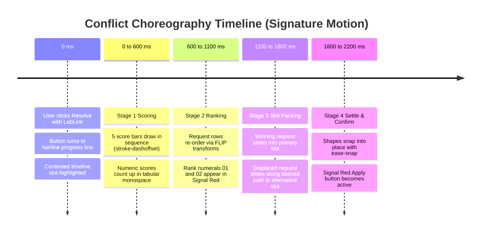

# Design System Specification: Swiss Grid & Geometric Identity
## Project: LabLink — Campus Laboratory Resource-Sharing Platform
**Status:** COMPLETE (Phase 1)  
**Style Core:** Swiss Modernism (Grid Rigidity, 1px Hairlines, Near-Black Ink, Signal Red) x Playful Inline SVG Geometry

---

## 1. Design Tokens Table

### 1.1 Color Tokens (Light Theme Hero Default)
| Token Variable | Hex Value | Primary Semantic Role | WCAG Contrast Ratio on `--paper` |
| :--- | :--- | :--- | :--- |
| `--paper` | `#FAFAF7` | Page background, uncolored canvas | Background baseline |
| `--ink` | `#0A0A0A` | Primary text, structural rules, solid black buttons | $18.2:1$ (Exceeds AAA) |
| `--ink-2` | `#3B3B38` | Secondary labels, descriptions, sub-headings | $9.1:1$ (Exceeds AAA) |
| `--ink-3` | `#5E5E59` | Tertiary timestamps, captions, disabled cues | $5.4:1$ (Exceeds AA) |
| `--rule` | `#0A0A0A` | Outer structural 1px grid divider lines | $18.2:1$ |
| `--rule-soft` | `#D6D6D0` | Inner table and skeleton divider lines | Structural divider |
| `--tint` | `#EFEFEA` | Highlighted cells, hover table rows, selected columns | Background tint |
| `--signal` | `#C00018` | Primary CTA, section numerals, selected tab | $5.6:1$ (WCAG AA Compliant) |
| `--signal-ink` | `#FFFFFF` | Text on Signal Red background | $5.6:1$ |
| `--cobalt` | `#1F3FD6` | AI-assisted badges, inline markdown links | $7.2:1$ |
| `--forest` | `#0B6B3A` | Confirmed bookings, available equipment state | $5.1:1$ |
| `--amber` | `#FFC400` | Warning fills, pending review status | Paired with ink text |

### 1.2 Color Tokens (Inverted Dark Theme `[data-surface="inverted"]`)
- `--paper`: `#0A0A0A`
- `--ink`: `#F4F4EF`
- `--ink-2`: `#C9C9C2`
- `--ink-3`: `#A3A39C`
- `--rule`: `#F4F4EF`
- `--rule-soft`: `#34342F`
- `--tint`: `#171715`
- `--signal`: `#FF5468`
- `--cobalt`: `#8FA2FF`
- `--forest`: `#4ADE9A`
- `--amber`: `#FFC400`

---

## 2. Typography Scale (Fluid Clamp)

| Token | CSS Definition | Weight | Tracking | Usage |
| :--- | :--- | :--- | :--- | :--- |
| `--fs-display` | `clamp(2.75rem, 1rem + 8.2vw, 8.5rem)` | 700 Bold | `-0.045em` | Hero display statement |
| `--fs-h1` | `clamp(2rem, 1.2rem + 3.6vw, 4.25rem)` | 700 Bold | `-0.035em` | Page main titles |
| `--fs-h2` | `clamp(1.5rem, 1.1rem + 1.6vw, 2.25rem)` | 600 SemiBold | `-0.02em` | Section headers in left rail |
| `--fs-h3` | `clamp(1.125rem, 1rem + 0.5vw, 1.375rem)` | 600 SemiBold | Normal | Equipment card titles |
| `--fs-body` | `clamp(1rem, 0.96rem + 0.2vw, 1.125rem)` | 400 Regular | Normal | Body text (Max line length: 68ch) |
| `--fs-label` | `0.75rem` (12px) | 600 SemiBold | `0.08em` | UPPERCASE section & table headers |
| `--fs-numeral-xl` | `clamp(2.5rem, 1.5rem + 4vw, 5rem)` | 700 Tabular | `-0.02em` | Monospaced live counter statistics |

---

## 3. Geometry Catalogue & Primitives

All geometric shapes are rendered from a shared `100x100` viewBox with 0px margin offsets.

```mermaid
flowchart LR
    subgraph Primitives["6 Standardized SVG Primitives"]
        P1["Circle<br>(100x100 r=50)"]
        P2["Square<br>(100x100 0r)"]
        P3["Quarter-Circle<br>(Signal Red Brand Anchor)"]
        P4["Right-Triangle<br>(45-deg directional)"]
        P5["Half-Circle<br>(Top/Bottom split)"]
        P6["Pill Bar<br>(100x40 rx=20)"]
    end

    subgraph EquipmentGlyphs["7 Category Glyphs"]
        G1["Compute: 2x2 Quarter-Circles"]
        G2["Embedded: Square + 4 Micro-Squares"]
        G3["Test: Circle over Pill Dial"]
        G4["Fabrication: Stacked Triangles"]
        G5["BioChem: Flask Circle + Cap"]
        G6["XR Media: Dual Facing Half-Circles"]
        G7["Networking: 3 Circles Linked by Pills"]
    end

    Primitives --> EquipmentGlyphs
```

---

## 4. Component Rules: Do's and Don'ts

| Element | DO | DON'T |
| :--- | :--- | :--- |
| **Containers & Cards** | Use 0px border-radius, 1px `--rule` borders, and `--tint` fills for active state. | Never use `rounded-md`, `rounded-lg`, or drop shadows (`shadow-sm`, `shadow-lg`). |
| **Buttons** | Flat rectangular 1px border with label on left and inline SVG arrow `→` on right. | Never use pill buttons, glossy gradients, or rounded button corners. |
| **Status Displays** | Pair an SVG geometric shape with an explicit text label (e.g., `● Available`). | Never use standalone colored dots with no accompanying text or shape distinction. |
| **Icons & Media** | Use 100% inline SVG components with square caps and miter joins. | Never load external icon fonts (FontAwesome), CDN icons, or raster images. |
| **Emojis** | Keep UI strictly institutional and typography-driven. | Never use emojis in any UI button, card, header, alert, or commit message. |
| **AI Markers** | Use the Cobalt four-point diamond `✦` and clear "AI-assisted" descriptor. | Never imply that AI confirmed a booking or made a binding allocation. |

---

## 5. Motion Catalogue & Budget

- Total motion JavaScript bundle: **$<4\text{ KB}$ gzipped** (zero third-party animation libraries).
- Powered by pure CSS transitions and Web Animations API (WAAPI).
- `prefers-reduced-motion` contract: Replaces all transforms and delays with immediate state presentation or 100ms opacity crossfade.

