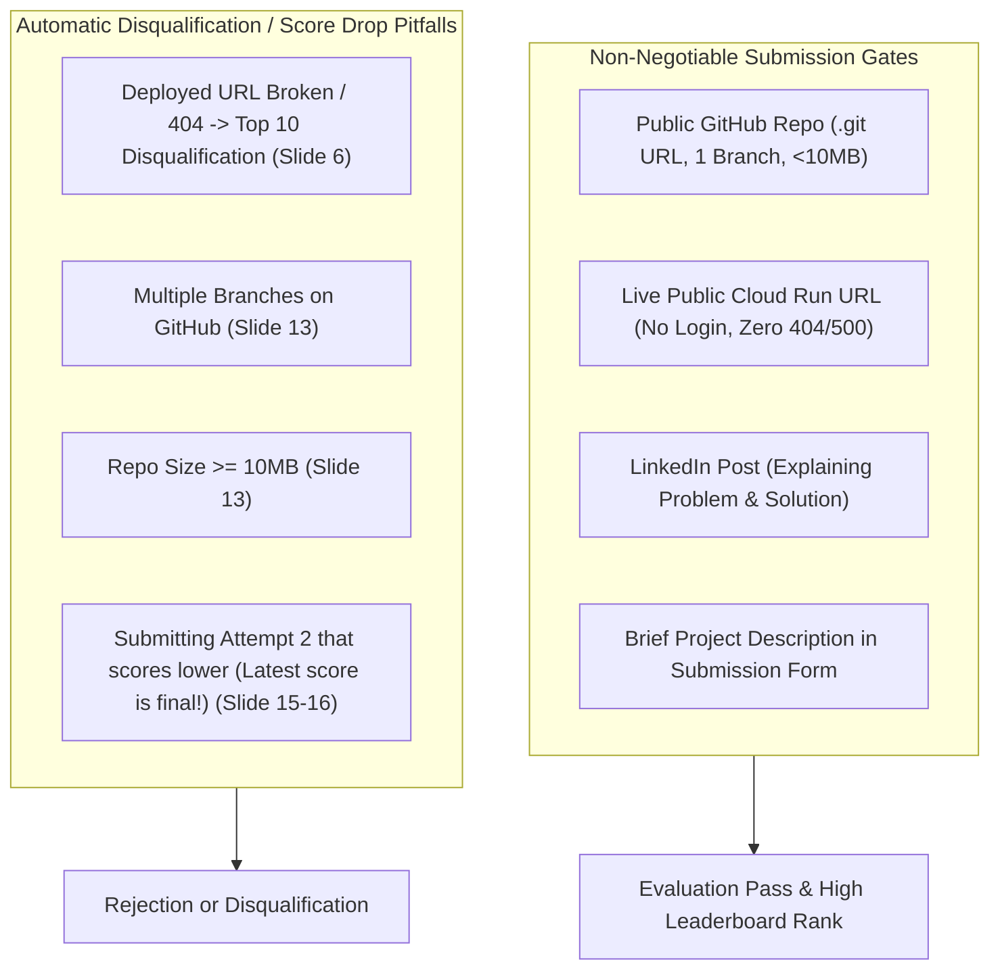
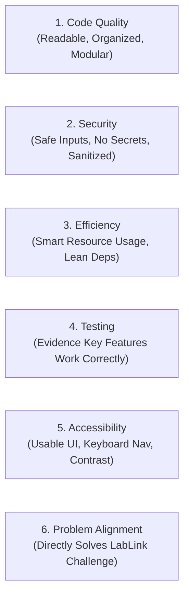

# PromptWars Hackathon: Rules, Evaluation & Submission Protocol
## Organizers: Cynergy Coding Club × Google for Developers (Build with AI / H2S)
**Status:** MANDATORY HARD CONSTRAINTS  
**Event:** PromptWars  
**Target Deadline:** 5:00 PM Asia/Kolkata  
**Verification Target:** 100% Compliance across all 26 Briefing Slides

---

## 1. Executive Summary & Critical Pitfalls

---

## 2. Complete Slide-by-Slide Rules Breakdown

### 2.1 The Three Required Submission Links (Slides 2, 3, 12, 13)
Participants must submit three distinct links on the Hack2Skill platform:

1. **GitHub Repository Link**:
   - **Public Access**: Must be published and publicly accessible without authentication.
   - **URL Format**: Must strictly end with `.git` (e.g., `https://github.com/sharancode3/PROMPTWARS.git`).
   - **Exactly One Branch**: Must contain only `main`. All auxiliary/feature branches must be removed before submission.
   - **Size Limit (< 10 MB)**: Exclude node_modules, build outputs, large binaries, datasets, and generated files. Strict `.gitignore` is mandatory.
2. **Deployed Project Link (Live Application)**:
   - Must be a working, publicly accessible deployment URL (Google Cloud Run / Vercel).
   - **No Login Wall**: Must function without private access, private keys, or invite-only permissions.
   - **Top 10 Rule (Slide 6)**: Top 10 finalists are selected based on Leaderboard score AND the working status of their deployment. **If your deployed link is not working, you will be disqualified (DQed) regardless of leaderboard rank.**
3. **LinkedIn Project Post Link**:
   - A public post explaining what you built and how it directly solves the assigned problem statement.
4. **Brief Project Description**:
   - Clear summary text entered into the platform submission field.

---

### 2.2 Evaluation Framework & The 6 Scoring Signals (Slides 4, 14)
An automated AI assessment evaluates every submission across 6 primary criteria. **Note:** The official briefing does not publish numeric weights for these signals; all six are assessed concurrently:

1. **Code Quality**:
   - Clean, readable, organized, and maintainable TypeScript architecture.
   - Clear folder structure, strict type definitions, zero `any` types, zero dead/commented-out code.
2. **Security**:
   - Safe input validation (Zod schemas), sanitization against XSS.
   - Zero hardcoded API keys, tokens, or credentials in Git history. `.env.example` only.
3. **Efficiency**:
   - Smart resource usage, lean dependencies, fast cold starts, sub-second response times.
   - Initial JavaScript bundle under budget, minimal container image footprint.
4. **Testing**:
   - Comprehensive automated unit and integration tests providing concrete evidence that key features work correctly (invariants, collision detection, fairness ranking, API routes).
5. **Accessibility (a11y)**:
   - Usable UI, full keyboard accessibility, visible focus rings, WCAG 2.1/2.2 AA contrast ratios, ARIA semantics.
6. **Problem Statement Alignment**:
   - Directly addresses LabLink requirements: cross-department equipment discovery, intelligent slot booking, project-based access, faculty approvals, and deterministic fair conflict resolution.

---

### 2.3 Attempts, Limits & Score Finality (Slides 5, 15, 16)

> [!CAUTION]
> **Your latest score counts — not your highest score.**  
> If Attempt 1 scores 90, and Attempt 2 scores 60, your final leaderboard score is **60** (Slide 16).

- **Submission Limits**: Up to **2 scored Challenge submissions**.
- **Retry Mechanism**:
  - One retry is provided **only** if a submission attempt fails due to a connectivity issue or technical platform error (where evaluation could not proceed).
  - A retry is **never** granted after an evaluation completes successfully.
- **Strategic Rule**:
  - Never rush Attempt 1. Complete, test, lint, and verify the deployment thoroughly.
  - Submit Attempt 2 **only** if Attempt 1 provides actionable platform feedback and the fix is verified to guarantee a higher score.

---

### 2.4 Account & Dashboard Access (Slide 9)
- **Email Match**: `REGISTERED EMAIL = LOGIN EMAIL`. The hackathon innovator dashboard depends on an exact email match.
- Keep dashboard access separate from demo application access (the demo application must remain open to all evaluators without login).

---

## 3. Pre-Submission Verification Checklist (Slide 17)

Before clicking **SUBMIT** on the Hack2Skill platform, verify every item:

| # | Check Item | Verification Command / Proof | Confirmed |
| :--- | :--- | :--- | :--- |
| 1 | **Exact Email Match** | Signed in with exact registration email | [ ] |
| 2 | **Public Repo** | Settings -> Danger Zone -> Visibility = Public | [ ] |
| 3 | **Exact One Branch** | `git branch -a` shows only `main` | [ ] |
| 4 | **.git URL Format** | `https://github.com/sharancode3/PROMPTWARS.git` | [ ] |
| 5 | **Size Under 10 MB** | `git count-objects -vH` shows size $<10\text{ MB}$ | [ ] |
| 6 | **Deployment URL Live** | Deployed URL responds HTTP 200 without auth wall | [ ] |
| 7 | **Conflict Demo Tested** | Golden conflict demo runs cleanly from cold browser session | [ ] |
| 8 | **LinkedIn Post Ready** | Post explains challenge and links solution | [ ] |
| 9 | **Test Suite Passing** | `npm test` passes with 0 failures | [ ] |
| 10 | **Clean Linter & Types** | `npm run lint` and `npm run typecheck` pass with 0 errors | [ ] |
| 11 | **Attempt Strategy Locked** | Attempt 1 is production-grade; Attempt 2 reserved | [ ] |
