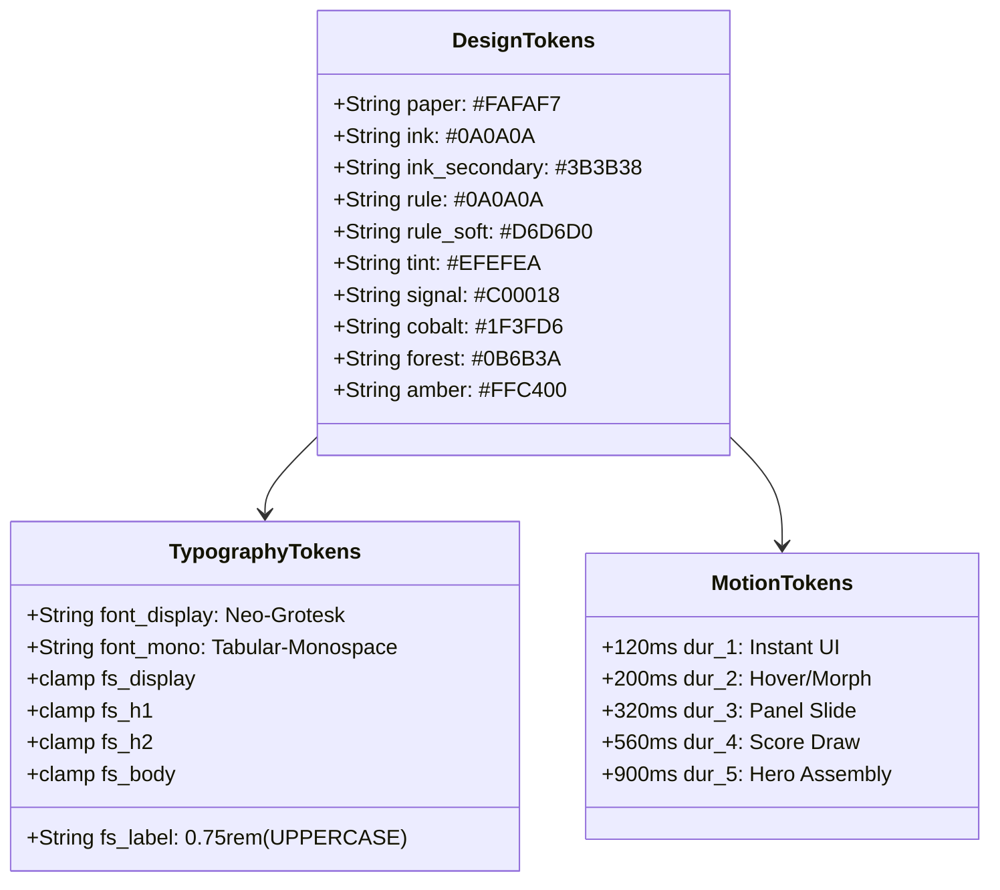
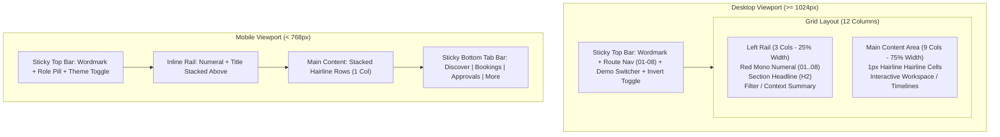
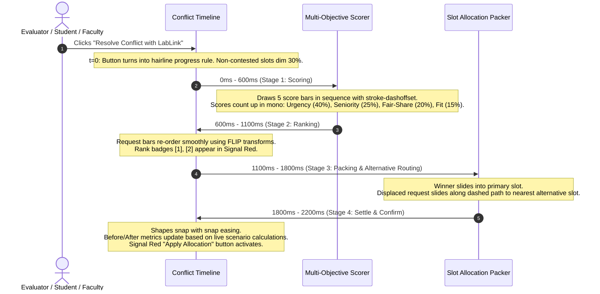
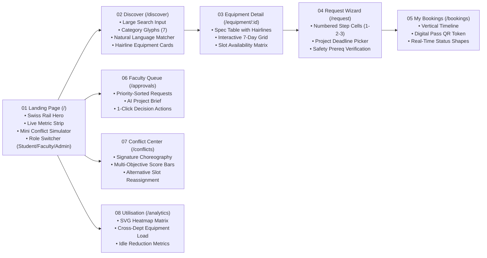

# UI/UX Design System: Swiss Minimalism x Playful Geometry
## Project: LabLink — Campus Laboratory Resource-Sharing Platform
**Status:** APPROVED SPECIFICATION (Replaces previous drafts)  
**Reference Source:** `05_UI_UX_SYSTEM.md`  
**Core Aesthetic:** Precision Swiss Grid, 1px Hairline Rules, Monospaced Accents, and Responsive Inline SVG Geometry.

---

## 0. Design Philosophy & Principles

LabLink adopts a **Swiss-Minimalist x Playful Geometry** aesthetic designed to convey institutional rigor, mathematical precision, and absolute transparency:

1. **The Swiss Grid & Hairlines**:
   - Layout built on an unyielding visible grid: **1px black hairline rules (`--rule`)** divide content into cells.
   - **Left Rail Architecture**: A sticky 25% left rail column hosts a small monospaced red numeral (`01`, `02`...) and section title, while the right 75% hosts the interactive content.
   - Flat, unadorned surfaces with **zero container border-radius** (strictly 0px radius for cards, tables, and dialogs; only geometric primitives and badges carry circular radius).
   - Zero drop-shadows and zero gradients. Visual elevation is communicated purely via hairline borders, `--tint` fills, and 1px offset outlines.
2. **Signal Red & High-Contrast Typography**:
   - Off-white paper background (`#FAFAF7`) paired with deep ink (`#0A0A0A`) and a singular, commanding Signal Red (`#C00018`) for primary CTAs, active route states, section numerals, and critical conflict warnings.
   - Tight, bold neo-grotesk headlines (`Inter Tight` / `Hanken Grotesk`) paired with tabular monospace numerals for stats, timestamps, and allocation scores.
3. **Playful Geometry & Purposeful Motion**:
   - Six inline SVG geometric primitives (circle, square, quarter-circle, triangle, half-circle, pill) bring kinetic personality and explain complex scheduling allocations.
   - Strict motion budget: Every transition explains cause and effect, with full `prefers-reduced-motion` compliance.

---

## 1. Non-Negotiable UI/UX Rules

1. **Zero Emojis Everywhere**: Strictly prohibited across UI, labels, documentation, code comments, and commit messages. All iconography and status indicators are **100% custom inline SVG**.
2. **Zero Heavy Raster Assets**: No JPG/PNG/WebP images. Total page asset weight is negligible; all visual graphics are math-driven inline SVG.
3. **Light Theme First**: Light paper is the hero default. An inverted dark theme (`--paper: #0A0A0A`) is fully supported and toggled via a persistent, accessible control.
4. **0px Container Radius**: Containers have 0 radius. Geometry shapes, status glyphs, and pills are the only circular elements.
5. **No Color-Only Signage**: Every color signal is paired with a distinct geometric shape, text label, or pattern.
6. **Intrinsic Responsiveness**: Mobile-first fluid CSS with container queries (`container-type: inline-size`). Zero horizontal page scroll at any viewport from 320px up to 2560px ultra-wide.

---

## 2. Design Tokens & Contrast System

### Color Palette (WCAG 2.1 AA & AAA Tested)
- `--paper`: `#FAFAF7` (Page background)
- `--ink`: `#0A0A0A` (Primary text, structural 1px rules, black fill buttons)
- `--ink-2`: `#3B3B38` (Secondary text, $\ge 7:1$ contrast on paper)
- `--ink-3`: `#5E5E59` (Captions and metadata, $\ge 4.5:1$ contrast)
- `--rule`: `#0A0A0A` (1px structural grid dividers)
- `--rule-soft`: `#D6D6D0` (Subtle inner table dividers)
- `--tint`: `#EFEFEA` (Hover rows, selected cell backgrounds)
- `--signal`: `#C00018` (Primary red action button, section numerals, selected indicator)
- `--signal-ink`: `#FFFFFF` (High contrast text on signal)
- `--cobalt`: `#1F3FD6` (AI-assisted tags and body hyperlinks only)
- `--forest`: `#0B6B3A` (Confirmed / Available status)
- `--amber`: `#FFC400` (Contested / Pending fill with ink text)

---

## 3. Responsive Screen Layout Architecture

---

## 4. Playful Geometry & Inline SVG Iconography

### 4.1 The Six Primitives
All geometric accents and decorative choreography are rendered from six base primitives defined on a standardized `100x100` SVG viewBox:
1. **Circle**: Neutral balance, used for status and equipment nodes.
2. **Half-Circle**: Semi-open state, used for pending approvals.
3. **Quarter-Circle**: Dynamic anchor (signal red in the LabLink brand mark).
4. **Square**: Rigid anchor, represents confirmed or allocated slots.
5. **Right-Triangle**: Directional vector, represents urgency and sort direction.
6. **Pill (Rounded Bar)**: Track container, used for timeline slots and category baselines.

### 4.2 Status Glyph System (Shape + Label)
To ensure accessibility without relying exclusively on color, every operational state combines an SVG geometric shape with an explicit text label:
- **Available**: Emerald Filled Circle `●` + "Available"
- **Booked / Occupied**: Ink Filled Square `■` + "Occupied"
- **My Booking**: Signal Red Diamond `◆` (Square rotated 45°) + "My Reservation"
- **Pending Review**: Half-Filled Circle `◐` + "Pending Faculty"
- **Contested Slot**: Triangle Warning `▲` + "Contested"
- **Approved**: Circle with Checkmark `✔` + "Approved"
- **AI-Assisted**: Cobalt Four-Point Diamond `✦` + "AI-assisted"

---

## 5. Conflict Resolution Choreography (Signature Interaction)

When competing project requests collide on high-demand laboratory equipment, the **Conflict Center (Route 07)** executes an explainable 4-stage visual choreography:

---

## 6. Route Map & Screen System

---

## 7. Interaction States & Form Logic

1. **Buttons**: Rectangular 0px border-radius, 1px ink border, minimum 48px height. Text on left, inline SVG arrow on right (`→`). On hover, ink fill sweeps in from left (200ms), arrow moves 4px right. On click, arrow snaps. On selected state, button turns Signal Red with checkmark glyph.
2. **Inputs**: 48px height, 1px bottom and side borders. When validated, small green check appears. When invalid, 1px Signal Red border with square error glyph and descriptive guidance.
3. **Demo Role Switcher**: Pinned to the top navigation header at all times:
   `Viewing as: [ Student (Alex) | Faculty Guide (Dr. Radhika) | Lab Admin (Mr. Verma) ]`
   Switching roles requires zero page reload and preserves created booking requests across views.
4. **Offline & AI Fallback Banner**: If `GEMINI_API_KEY` is not present, a persistent subtle banner states:
   `"✦ Engine: Rule-Based Heuristic Matcher Active (Zero External Dependencies)"`
