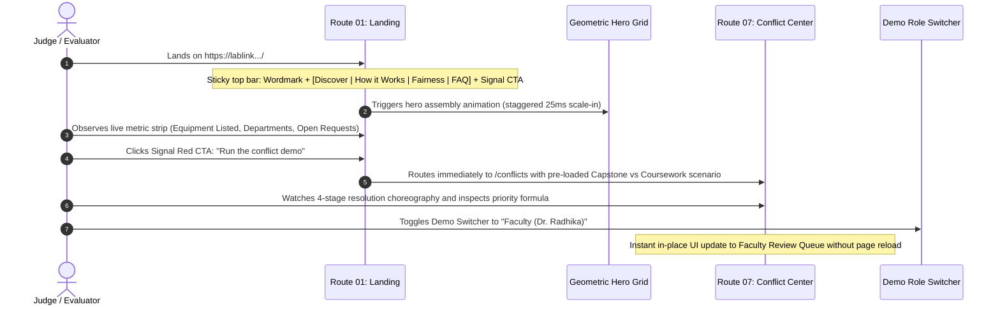

# User Experience (UX) Specification & Screen Storyboards
## Project: LabLink — Campus Laboratory Resource-Sharing Platform
**Status:** STORYBOARD REFERENCE  
**Target Viewports:** 320px (Mobile S) to 2560px (Ultra-wide)  
**Standard:** WCAG 2.2 AA Accessible

> [!NOTE]
> `docs/UX_SPEC.md` serves as a screen flow storyboard. Where visual tokens, styling, or component details in this document conflict with the approved `docs/UI_UX.md` and `docs/DESIGN_SYSTEM.md`, **`docs/UI_UX.md` and `docs/DESIGN_SYSTEM.md` take precedence**. Useful screen-flow and interaction journeys are preserved here.

---

## 1. Landing Page Storyboard (`/`)

The landing page provides immediate comprehension within 5 seconds and allows evaluators to run the live Conflict Resolution Demo within 60 seconds without logging in.

### 1.1 Section Breakdown (Rail + Content Architecture)
- **01 Hero**: Left rail displays `01` in Signal Red mono. Right column: Headline *"Shared labs, fairly allocated."*, summary paragraph, and dual CTAs: `"Run the conflict demo" →` (Signal Red) and `"Explore equipment" →` (Outline). Underneath sits the interactive 6x4 geometric calendar canvas.
- **02 The Problem**: Left rail displays `02 Why labs sit idle`. Two-column hairline grid comparing current university bottlenecks vs. LabLink's automated cross-department discovery.
- **03 How it Works**: **Inverted Black Section** (`[data-surface="inverted"]`). Four hairline cells with white grotesque numerals `01` to `04` illustrating Discover, Request, Approve, and Resolve.
- **04 See a Conflict Resolve**: Interactive mini-simulator running client-side with 3 competing mock requests.
- **05 Fairness, Explained**: Visual breakdown of the multi-objective mathematical formula with 5 interactive weight sliders.
- **06 What You Can Do**: 6-cell hairline grid linking directly to the core application modules.
- **07 Equipment Across Campus**: Horizontal wrap of the 7 equipment category glyphs with live counts.
- **08 Choose How You Explore**: 3-column role picker (Student Alex, Faculty Dr. Radhika, Admin Mr. Verma). Clicking immediately enters the app with that role selected.
- **09 FAQ Accordion**: 6 key questions with keyboard-expandable panels.
- **10 Institutional Footer**: Git link, PromptWars x Cynergy badge, WCAG compliance statement, theme toggle.

---

## 2. Application Core Screen Storyboards

### 2.1 Route 02: Discover (`/discover`)
- **Left Rail**: `02 Discover` + Filter pills by department (CSE, ECE, Mech, Bio, Physics) and category.
- **Search Header**: Huge 48px display-adjacent search input: *"Describe project goals or hardware requirements..."*
- **AI Feedback**: If query contains natural language, system highlights extracted capability tags (e.g. `✦ Extracted: [Tensor Cores, 64GB RAM]`) with a Cobalt diamond indicator.
- **Card Grid**: Responsive auto-fit hairline grid (`repeat(auto-fit, minmax(min(100%, 18rem), 1fr))`). Each cell displays category SVG glyph, equipment name, department, status shape, and 1-click `"Book Slot" →` button.

### 2.2 Route 03: Equipment Detail & Interactive Calendar (`/equipment/:id`)
- **Left Rail**: `03 Equipment` + Technical specifications table (TOPS, RAM, interfaces, safety cert requirements).
- **Calendar Matrix**:
  - Desktop ($\ge 1024\text{px}$): 7-Day horizontal week grid with 1-hour time blocks (08:00 to 20:00).
  - Tablet ($768\text{px} - 1023\text{px}$): 3-Day grid with prev/next navigation.
  - Mobile ($<768\text{px}$): Single-day view with horizontal date strip and list-based agenda view.
- **Slot Selection**: Clicking an open slot highlights it with an inset red outline; clicking a contested slot opens the Conflict Arbitrator explanation preview.

### 2.3 Route 06: Faculty Approvals Queue (`/approvals`)
- **Left Rail**: `06 Approvals` + Pending counter badge (`3 Pending Decisions`).
- **Master-Detail Flow**:
  - Master List: Hairline table rows showing Student Name, Project Title, Deadline Countdown, and Priority Score ($0-100$).
  - Detail Drawer / Panel: Displays AI-generated 3-bullet project justification, prerequisite verification checkmark, and three decisive action buttons:
    - `"Approve & Issue Pass" →` (Signal Red)
    - `"Suggest Alternate Slot" →` (Outline)
    - `"Reject with Feedback" →` (Muted Outline)

### 2.4 Route 07: Conflict Center (`/conflicts`)
- Houses the signature 4-stage conflict choreography.
- Displays the contested time slot (e.g., `Thursday 14:00 - 16:00, NVIDIA Jetson AGX Orin`).
- Shows competing requests:
  - **Request A (Alex)**: Senior Capstone, Deadline in 3 days, Prior usage: 4h $\rightarrow$ **Priority Score: 89.5**.
  - **Request B (Jordan)**: Sophomore Lab Practice, Deadline in 18 days, Prior usage: 12h $\rightarrow$ **Priority Score: 52.0**.
- Shows instant alternative rebooking options for the displaced request.

---

## 3. UX Logic Principles & Edge-Case Rules

1. **One Primary Action per View**: Only one Signal Red button exists per screen, eliminating decision paralysis.
2. **Deterministic Booking Guard**: Slots outside operating hours (08:00–20:00) or missing prerequisites are rendered in an inert disabled state with an explicit explanatory tooltip.
3. **Optimistic UI with Rollback**: Booking requests update state immediately ($<50\text{ms}$), displaying an undo toast for 8 seconds.
4. **Honest AI Disclosure**: All AI-assisted suggestions display the Cobalt four-point diamond `✦` and explicit label: *"AI-assisted proposal. Faculty retains final approval."*
