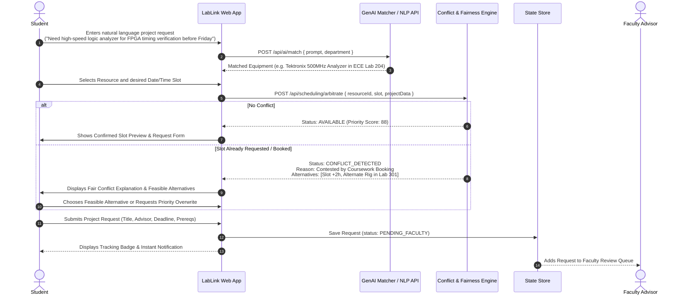
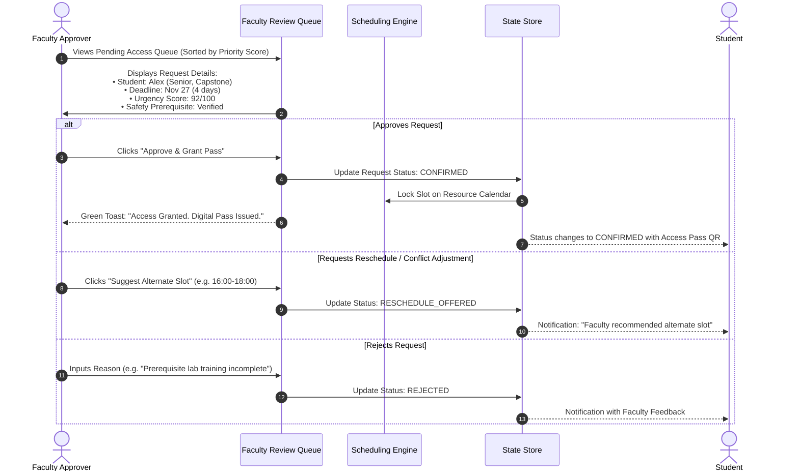
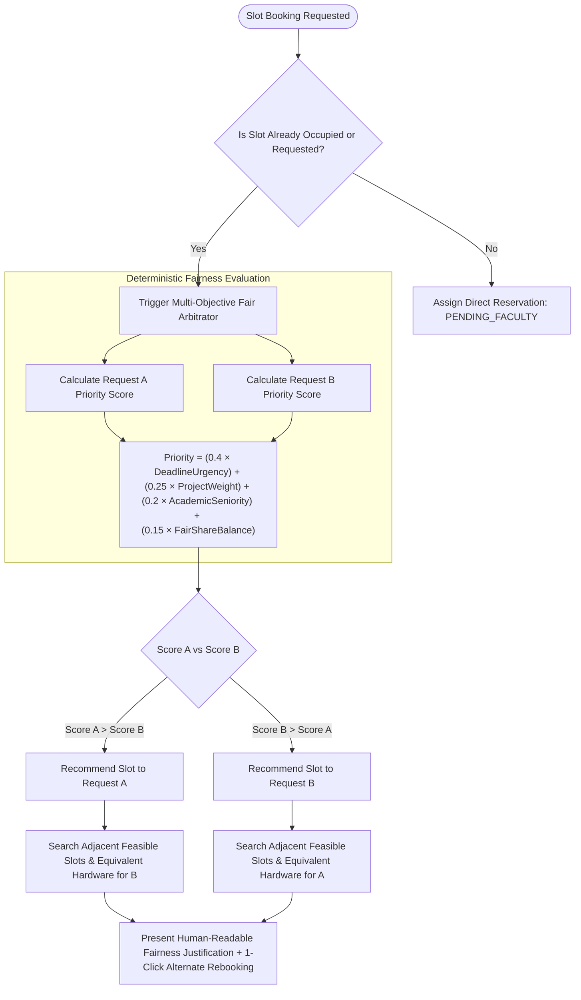

# System Workflows & User Journeys
## Project: LabLink — Campus Laboratory Resource-Sharing Platform
**Status:** DRAFT (Phase 1: Discovery & Planning)

---

## 1. End-to-End User Workflows

### 1.1 Student Discovery to Access Request Flow

---

### 1.2 Faculty Review and Approval Flow

---

## 2. Fair Scheduling & Conflict Resolution Flow

When multiple students seek access to the same equipment window:

---

## 3. Edge Cases & Exception Handling

| Edge Case | Detection Mechanism | System Action & UX Resolution |
| :--- | :--- | :--- |
| **Simultaneous Slot Collisions** | Two users submit the same slot within milliseconds | Atomic optimistic locking in state layer. First processed gets primary hold; second gets real-time notice with next immediate alternative. |
| **Approaching Hard Deadline** | Request project deadline is $<24\text{ hours}$ away | Priority score gets an urgency boost ($+25\text{ pts}$); highlighted with a red flame badge in the Faculty review queue. |
| **Missing Safety Certification** | Resource requires "Hazardous Chemicals" or "Class 4 Laser" cert | Booking button displays disabled state: *"Safety Prerequisite Required: Laser Module 1"*, with link to clear prerequisite. |
| **Off-Hours Booking Attempt** | Request submitted for 22:00 (Lab hours: 08:00–20:00) | Hard constraint check immediately prevents slot selection: *"Requested time falls outside lab operating hours (08:00–20:00)"*. |
| **External AI API Down / Missing Key** | Gemini API network timeout or absent env key | Silent fallback to built-in keyword/tag-based heuristic matching engine. Banner alerts: *"Running in deterministic offline mode"*. Zero crash or unhandled promise rejection. |
| **Evaluator Demo Switch** | Evaluator tests student submission, then switches to faculty | Role switch header instantly toggles simulated user context (`alex_student` $\leftrightarrow$ `dr_radhika_faculty`), preserving created state so the evaluator sees their newly created request immediately in the faculty queue. |
